<a href="https://github.com/NotAScratch/Autonomous-Mapping-and-Navigation">
  
</a>

  
  
  

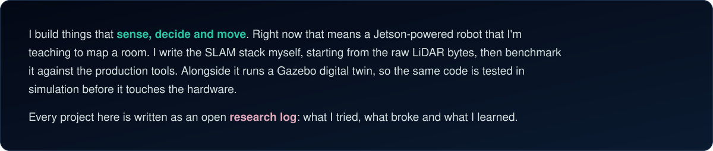

## Featured research

  <a href="https://github.com/NotAScratch/Autonomous-Mapping-and-Navigation">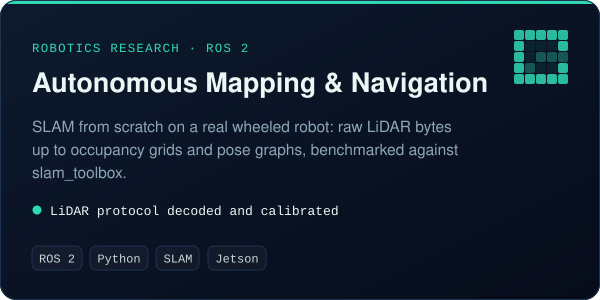</a>
  <a href="https://github.com/NotAScratch/rosmaster-r2-sim">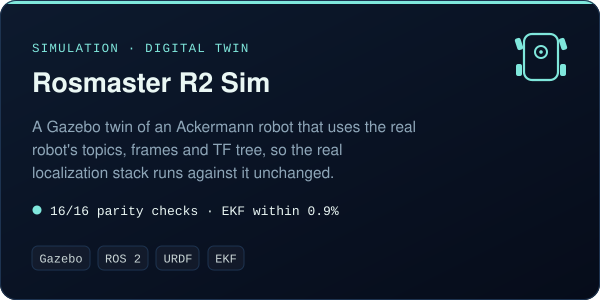</a>
  <a href="https://github.com/NotAScratch/Monkey-Deterrence">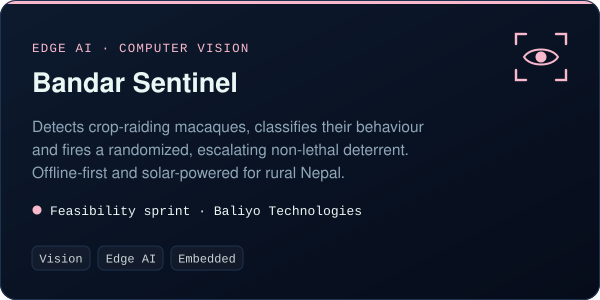</a>
  <a href="https://github.com/NotAScratch/AQI-Monitor">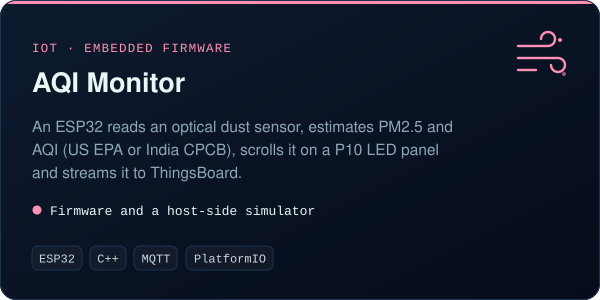</a>

## Lab status

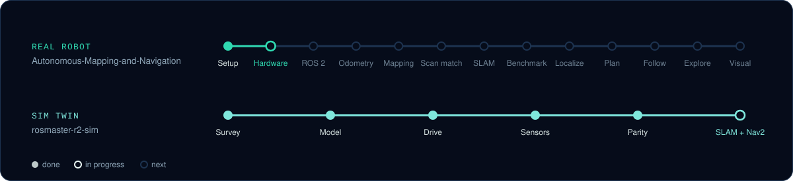

<b>Recent findings</b>

 

- **Don't trust device names.** `/dev/rplidar` and `RPLIDAR_TYPE` pointed to a Slamtec RPLidar. Tracing the vendor launch files showed the sensor is actually a **YDLIDAR 4ROS** at 512000 baud. I now decode its packet protocol with my own code.
- **The real EKF runs unchanged in simulation.** It matches within 0.9% on distance and 2.8% on turning.
- **A bug the twin surfaced:** the robot's shipped EKF config fuses two absolute yaw sources, which makes `/odom` zig-zag.

## More from the lab

<a href="https://github.com/NotAScratch/FYP_Object_detection">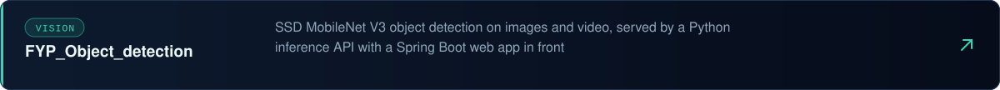</a>
<a href="https://github.com/NotAScratch/Real-Time-Object-Detection-and-Distance-Measurement-with-Computer-Vision">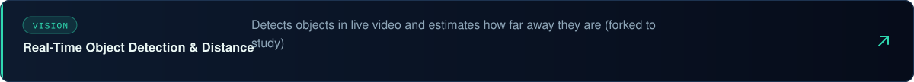</a>
<a href="https://github.com/NotAScratch/Neural-Networks">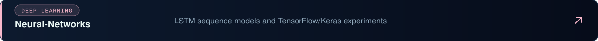</a>
<a href="https://github.com/NotAScratch/Natural-Language-Processing">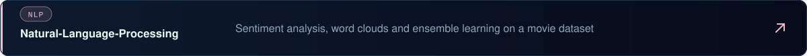</a>
<a href="https://github.com/NotAScratch/AI">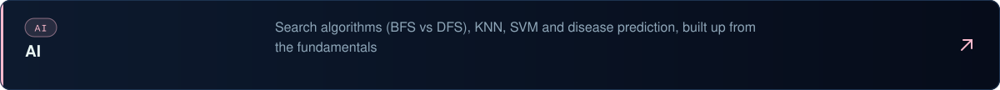</a>
<a href="https://github.com/NotAScratch/Weather-Prediction">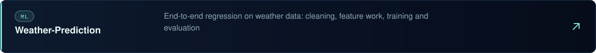</a>
<a href="https://github.com/NotAScratch/House-Price-Prediction">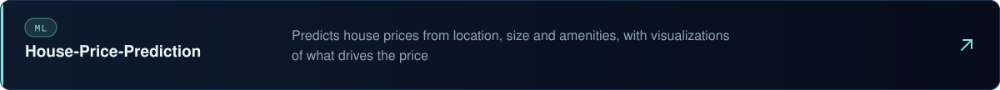</a>
<a href="https://github.com/NotAScratch/Learning-Pyspark">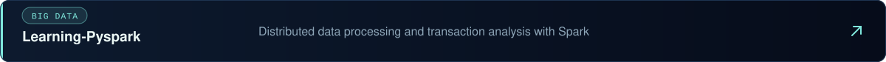</a>
<a href="https://github.com/NotAScratch/ESP-32-DHT-11-gsm-module-live-humidity-and-temprature-monitoring">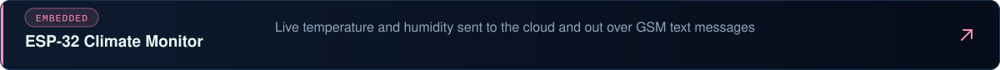</a>
<a href="https://github.com/NotAScratch/Arduino-BT-CAR">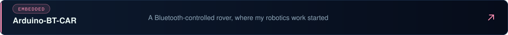</a>

## Also in the works

Private or early-stage. More when they're ready.

- 🦾 **A second robot platform:** bringing up a larger, more agile robot base
- 🛒 **Retail robotics:** an interactive in-store robot built to catch shoppers' attention
- 🎯 **Vision-based tracking:** following moving targets in real time
- 🌾 **Agri-tech:** digital tools for farms and the supply chains around them
- 🏠 **A property platform** for the local market
- 📱 **An offline-first mobile app** for exam preparation
- 💼 **A job-matching platform**

## Toolbox

**Robotics** &nbsp;

**AI / ML** &nbsp;

**Embedded** &nbsp;

**Languages & backend** &nbsp;

---

  Off the keyboard: ♟️ chess · 🃏 poker · 🎣 fishing · ⚽ football 
  <i>Curious by default. Building to find out.</i>

